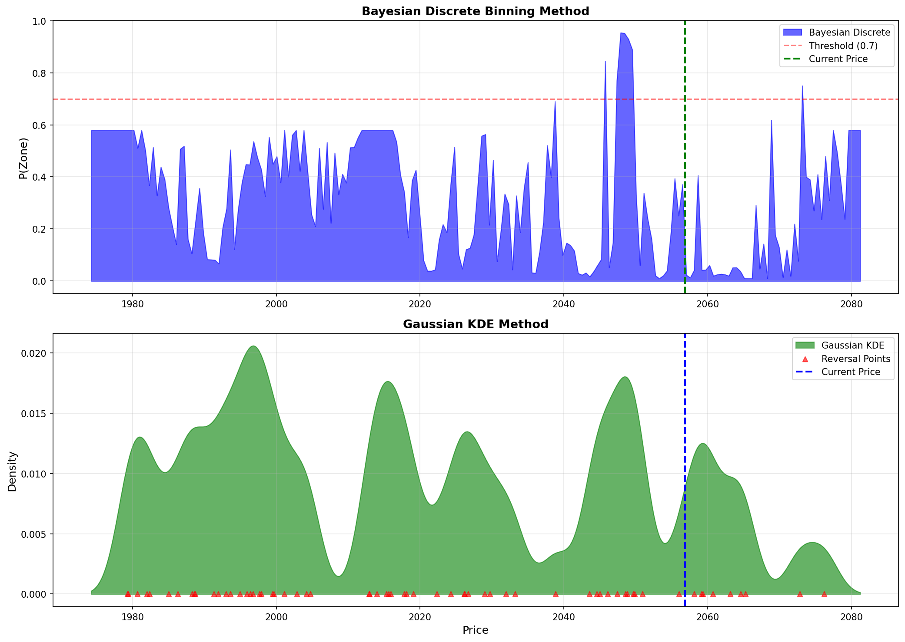
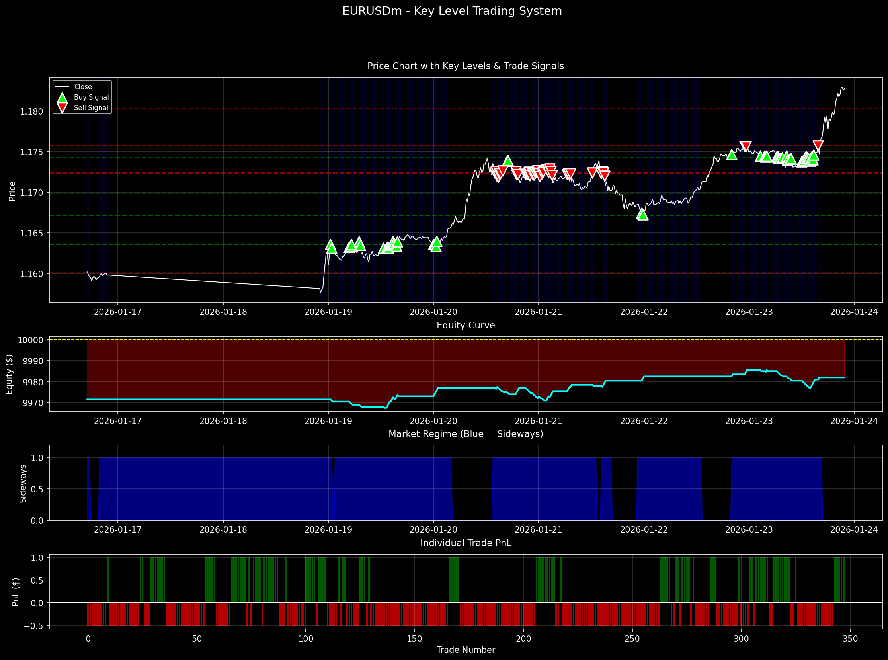
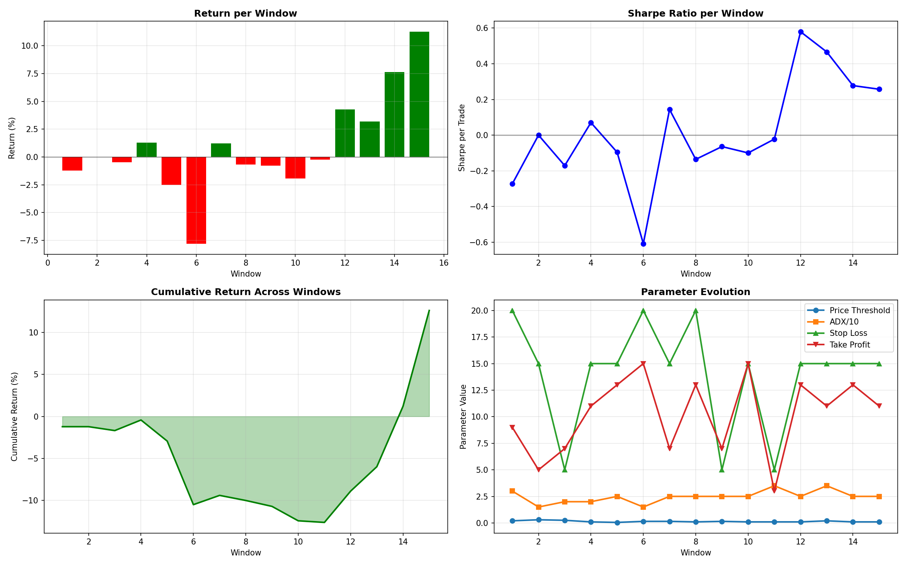
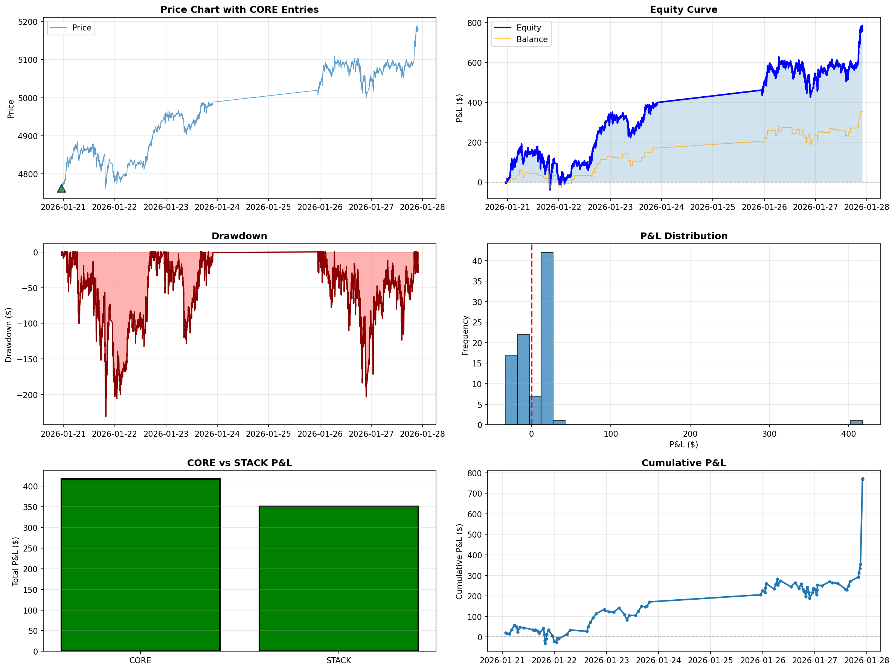

# Structure Analyzer

Research scripts for market-structure trading on gold (XAUUSD), EUR/USD and index CFDs through MetaTrader 5. The repo covers market-regime labelling, supply/demand and key-level detection (including Bayesian and KDE zone scoring), neural networks trained on those labels, backtests and parameter optimisers, Streamlit dashboards, and a few live MT5 trading bots.

> **Research and education only.** Several scripts send real orders through MetaTrader 5. Run them on a demo account. No script checks that the connected account is a demo account.

## Where to start

| If you want to... | Run |
|---|---|
| Explore market regimes interactively | `streamlit run dashboard.py`: multi-timeframe entropy and ADX heatmaps with a built-in backtest |
| Test a candlestick-pattern strategy interactively | `streamlit run volatility_dashboard.py` |
| See the most complete backtest | `backtest_don_strat.py`: replays the live `don_strat.py` bot on M1 gold with a simulated spread, then prints a report, saves a 6-panel chart and writes a trade log |
| Follow one research loop end to end | `key_level_trading_system.py` → `optimize_key_level_system.py` → `extended_backtest.py` |
| Check robustness out of sample | `walk_forward_optimization.py` |
| Try something without MetaTrader 5 | `python bayesian_zone_integration_demo.py` (synthetic data) |

## Tech stack

- Python, the `MetaTrader5` API (market data and order execution)
- pandas, NumPy, SciPy, TA-Lib, pandas-ta
- scikit-learn, TensorFlow/Keras
- Optuna, backtesting.py, numba
- matplotlib, seaborn, Plotly, Streamlit
- yfinance, PyWavelets, python-dotenv, requests (Discord alerts)

## How the pieces fit

```
regime_labeler.py ──► train_regime_predictor.py
regime_labeler.py ──► detect_supply_demand_zones.py (+ bayesian_supply_demand_zones.py)
                              │  zone_labels_bayesian_for_ml.csv
                              ▼
      train_zone_ensemble.py · train_volume_dynamics.py · ultimate_ensemble_test.py
                                                             │  model_order_flow.keras
                                                             ▼
      backtest_order_flow.py · use_order_flow_model.py · analyze_low_probability.py · live_order_flow_trader.py

key_level_detector.py + regime_labeler.py ──► key_level_trading_system.py ──► optimize_key_level_system.py
                                                                          ──► visualize_optimized_system.py, extended_backtest.py
key_level_detector.py ──► key_level_labels.csv ──► train_key_level_predictor.py

analyze_momentum.py ──► backtest_momentum_scalper.py ──► optimize_momentum_scalper.py ──► walk_forward_optimization.py

optimized.py, adaptive.py (tick-data research) ──► gold_bot.py, gold_sniper.py (same patterns and parameters as optimized.py)
                                                  ──► gold_bot_modified.py, gold_bot_stacking.py (tuned variants), started via launcher.py
backtest_don_strat.py, backtest_don_long_term_strat.py ◄─► don_strat.py, don_long_term_strat.py (live)
```

## Project structure

All 59 scripts sit in the repo root. The tables group them by purpose. The "Writes" column lists the files a script saves. Where a matching file is committed to the repo, it came from that script.

### Dashboards (Streamlit)

| Script | What it does | Writes |
|---|---|---|
| `dashboard.py` | "Market Regime Dashboard": permutation entropy of an EMA and ADX direction across M15 to W1 as heatmaps, confluence shading, VWMA-crossover signals with optional entropy and ADX filters, an ATR-based backtest (Sharpe, return, max drawdown) and a playback slider | none |
| `volatility_dashboard.py` | TA-Lib candlestick patterns filtered by ATR volatility, trading session and RSI. Includes a fixed-lot backtest with ATR stop and target, trailing stop, time stop and a consecutive-loss cooldown. MT5 login is entered in the sidebar | none |
| `volatility_compression.py` | "Physics-Based Volatility Bands": ATR bands around the previous day's high and low, with EMA velocity and acceleration used for breakout and reversal entries and a trailing-stop backtest. Data comes from MT5 or Yahoo Finance | none |
| `bb_entropy_dashboard.py` | Bollinger Band width and its permutation entropy, with stable and chaotic regimes shaded | none |

### Market regime and structure analysis

| Script | What it does | Writes |
|---|---|---|
| `regime_labeler.py` | `RegimeLabelGenerator`: labels bars sideways or trending using ADX, linear regression, volatility ratio, the Hurst exponent and a 2-of-3 consensus. Other scripts import it | `regime_labeling_comparison.png`, `regime_labels_consensus.csv` |
| `market_regime.py` | Permutation entropy, ADX and ATR chart for XAUUSDm M5 | on-screen chart |
| `mtf_ma_entropy.py` | Script version of the dashboard's multi-timeframe EMA entropy and ADX heatmaps | on-screen chart |
| `sr_retest_entropy.py` | Fractal support/resistance levels, with permutation entropy measured during retests | on-screen chart |
| `detect_sideways_markets.py` | Sideways detection from rolling range, ADX, regression slope and volatility | `sideways_detection.png` |
| `analyze_bollinger_bands.py` | Distance from the Bollinger Bands, with its velocity and acceleration | `bollinger_band_analysis.png` |
| `multi_bb_confluence.py` | Breakouts that happen across BB periods 20, 50, 100, 300 and 500 at once | `multi_bb_confluence.png` |
| `analyze_momentum.py` | High-momentum zones (large price change plus high ADX) | `high_momentum_analysis.png` |
| `visualize_cycles.py` | Dominant price cycles via an FFT periodogram and a continuous wavelet transform | on-screen chart |
| `analyze_price_range.py` | Prints range, quartiles and trend/range verdict for 3000 EURUSDm M15 bars | console only |
| `candle_tick_viewer.py` | Tick-by-tick view inside one M15 candle, with permutation entropy | `tick_chart_EURUSDm.png`, optional ticks CSV |
| `tick_spike_analyzer.py` | Price spikes in the last hour of ticks (z-score, velocity, volatility methods) | `tick_spikes_EURUSDm.png`, optional CSV |

### Zone and key-level detection

| Script | What it does | Writes |
|---|---|---|
| `bayesian_supply_demand_zones.py` | Library with `BayesianZoneDetector` (price-bin Bayesian updates with time decay) and `GaussianKDEZoneDetector`. Run directly, it uses synthetic data and needs no MT5 | `bayesian_zones_discrete.png`, `bayesian_zones_kde.png`, `bayesian_zones_comparison.png` |
| `detect_supply_demand_zones.py` | `SupplyDemandZoneDetector`: swing-point zones in sideways regimes, with reversal validation, KMeans clustering, Bayesian/KDE scoring and M15/H1/H4 confluence. Opens a Plotly chart and exports ML labels | `supply_demand_zones_bayesian.csv`, `zone_labels_bayesian_for_ml.csv` |
| `bayesian_zone_integration_demo.py` | Offline demo that scores traditional zones with Bayesian and KDE probabilities (40/40/20 composite) on synthetic data | `bayesian_integration_demo.png`, `bayesian_zones_demo.csv` |
| `bayesian_zone_threshold_guide.py` | Reference guide to composite-score thresholds. Prints recommendations | console only |
| `plot_zones_simple.py` | Draws zones from `supply_demand_zones_bayesian.csv` over MT5 prices (Plotly) | browser chart |
| `key_level_detector.py` | `KeyLevelDetector`: swing points, percentile-based support/resistance levels and proximity labels | `key_levels_chart.png`, `key_level_labels.csv` |

### Machine-learning models

| Script | What it does | Writes |
|---|---|---|
| `train_regime_predictor.py` | Keras network that predicts the next candle's regime, using labels from `regime_labeler.py` | `regime_prediction_results.png`, `regime_predictor_model.h5` |
| `train_zone_predictor.py` | Multi-output Keras network: near supply/demand (classification) and distance to zone (regression) | `zone_predictor_training.png`, `zone_predictions_chart.png`, `zone_predictor_model.h5` |
| `train_zone_formation_predictor.py` | Network with focal loss that predicts when a new zone will form within 10 bars | console only |
| `train_zone_ensemble.py` | Five specialist networks (price action, volume, volatility, regime, multi-timeframe) trained on the zone labels | `zone_nn_<group>.keras` |
| `train_volume_dynamics.py` | Network trained on volume velocity and acceleration features | `volume_dynamics_nn.keras` |
| `ultimate_ensemble_test.py` | Seven specialist networks (order flow, market structure, momentum exhaustion, trend reversal, volatility breakout, divergence, Fibonacci), ranked by test AUC, plus a top-3 averaged ensemble | `model_<name>.keras` (including `model_order_flow.keras`) |
| `train_key_level_predictor.py` | Network that predicts whether price is at a key level | `key_level_predictor.h5` |
| `train_nn.py` | scikit-learn MLP that predicts the next M1 candle's direction on XAUUSDm from multi-timeframe entropy and ADX features | `trend_mlp.pkl`, `trend_scaler.pkl` |
| `train_q_learning.py` | Tabular Q-learning over 50 KMeans market states, evaluated with walk-forward folds | `walk_forward_equity.png`, `regime_kmeans.pkl`, `regime_scaler.pkl`, `q_table.npy` |
| `use_order_flow_model.py` | Prints the current reversal signal from `model_order_flow.keras`. Places no orders | console only |
| `analyze_low_probability.py` | Compares low reversal-probability periods from the order-flow model with trend acceleration | `low_probability_analysis.png` |

### Backtests and optimisation

| Script | What it does | Writes |
|---|---|---|
| `backtest_don_strat.py` | Replays the `don_strat.py` CORE/STACK logic on 7 days of XAUUSDm M1 data with a simulated spread. Full performance report | `backtest_results.png`, `backtest_trades.csv` |
| `backtest_don_long_term_strat.py` | The same harness for `don_long_term_strat.py` | `backtest_long_term_results.png`, `backtest_long_term_trades.csv` |
| `key_level_trading_system.py` | Reversal entries at key levels during sideways regimes, with backtest and chart | `key_level_trading_system.png` |
| `optimize_key_level_system.py` | Grid search over TP/SL, level proximity, level strength and RSI/volume filters, targeting Sharpe per trade of at least 0.2 | console only |
| `visualize_optimized_system.py` | Runs the optimised key-level configuration and charts it | `optimized_key_level_system.png` |
| `extended_backtest.py` | Optimised key-level configuration on 5000 bars, with a monthly breakdown | `extended_backtest_trades.csv` |
| `backtest_momentum_scalper.py` | Momentum-zone scalper with fixed pip targets | `momentum_scalper_equity.png` |
| `optimize_momentum_scalper.py` | Optuna search for the scalper using a train/test split | `optuna_optimization.png`, `equity_curves.png` |
| `walk_forward_optimization.py` | Rolling walk-forward Optuna optimisation of the scalper | `walk_forward_analysis.png` |
| `scalping_optimizer.py` | Grid search across mean-reversion, momentum and breakout scalping strategies on EURUSDm M1 | `scalping_optimization_results.json`, `equity_curve.png` |
| `backtest_breakout_hedging.py` | On a breakout from consolidation, opens long and short together, cuts the loser and trails the winner | `breakout_hedging_equity.png` |
| `backtest_order_flow.py` | Backtests `model_order_flow.keras` signals (0.7 threshold, 20-pip stop, 5-pip trail) on held-out bars | `order_flow_equity_curve.png` |
| `backtest_gold_quant.py` | "MomentumSlopeV2" strategy (rolling regression slope and R², RSI, chandelier stop) in backtesting.py, tuned with Optuna | interactive Bokeh chart (`MomentumSlopeV2.html` matches this output) |
| `optimized.py` | "Infinity Runner" backtest on multi-year XAUUSDm tick CSVs resampled to M5: candlestick patterns, RSI filter, ATR stop, break-even, then a stepped trailing stop | `data/XAU_5mins_resampled.parquet`, `infinity_runner_no_stacking.html` |
| `adaptive.py` | Optuna fits separate normal and high-volatility parameter sets for the same strategy (70/30 train/test split) | `full_equity_PURE.html` |

### Live trading bots and launchers (place real orders)

| Script | What it does | Writes |
|---|---|---|
| `gold_bot.py` | XAUUSDm M5: candlestick pattern plus RSI entry, ATR stop and target, then break-even and a stepped trailing stop. Discord alerts. CLI flags `--path --magic --symbol` | none |
| `gold_sniper.py` | The same strategy for multi-account use (`--path` is required; alerts are tagged with the magic number) | none |
| `gold_bot_modified.py` | Variant with no take-profit, only the High-Wave and Engulfing patterns, and server hours 9, 16 and 20 skipped | `trade_audit_log.csv` |
| `gold_bot_stacking.py` | Same filters, but allows up to 20 concurrent positions | `trade_audit_log.csv` |
| `launcher.py` | Starts the bot scripts in separate Windows consoles, one per MT5 terminal listed in `BOTS` | none |
| `vol_strat.py` | XAUUSDz M5: ATR-expansion plus reversal-pattern entries, ATR stop and target, trailing stop, time stop and loss cooldown | `trade_log.csv` |
| `don_strat.py` | XAUUSDm M1 CORE/STACK bot: CORE trades on strong-bodied candles, STACK add-ons, fixed profit/loss exits, account-floor shutdown | none |
| `don_long_term_strat.py` | Slower CORE/STACK variant with wider exits and at most one STACK | none |
| `live_order_flow_trader.py` | Trades `model_order_flow.keras` signals on closed EURUSDm M15 candles | none |
| `start_live_trader.py`, `start_live_trader.bat` | Open `live_order_flow_trader.py` in a new console window | none |

### Saved models and data

- Keras models: `model_*.keras`, `zone_nn_*.keras`/`.h5`, `volume_dynamics_nn.keras`, `zone_predictor_model.h5`, `regime_predictor_model.h5`, `key_level_predictor.h5`
- scikit-learn and Q-learning artefacts: `trend_mlp.pkl`, `trend_scaler.pkl`, `regime_kmeans.pkl`, `regime_scaler.pkl`, `q_table.npy`
- Label sets used for training: `zone_labels_bayesian_for_ml.csv`, `zone_labels_for_ml.csv`, `supply_demand_zones*.csv`, `key_level_labels.csv`, `regime_labels_consensus.csv`

### Misc

`wifi_restart.py` and `wifi_log.txt` are a Windows network-adapter watchdog and its log. They are not part of the trading research.

## Getting started

### Prerequisites

- 64-bit Windows with the MetaTrader 5 desktop terminal installed and logged in to a demo account. 49 of the 59 scripts import the `MetaTrader5` package, which talks to the local terminal and only ships for Windows.
- Python 3. No version is pinned in the repo. With current package releases, 3.12 or 3.13 satisfies TensorFlow, pandas-ta and PyWavelets.

Some scripts don't need the `MetaTrader5` package:

- From synthetic data or committed CSVs: `bayesian_supply_demand_zones.py`, `bayesian_zone_integration_demo.py`, `bayesian_zone_threshold_guide.py`, `train_key_level_predictor.py`, `train_volume_dynamics.py` and `ultimate_ensemble_test.py`.
- From tick CSVs you supply in `data/`: `optimized.py` and `adaptive.py`.

On macOS or Linux, remove `MetaTrader5` from `requirements.txt` before installing.

### Install

```bat
python -m venv venv
venv\Scripts\activate
pip install -r requirements.txt
```

TA-Lib now ships prebuilt wheels. If pip tries to compile it, install the TA-Lib C library first.

### Configure

Create a `.env` file in the repo root (it is already in `.gitignore`):

```ini
MT5_LOGIN=
MT5_PASSWORD=
MT5_SERVER=
MT5_PATH=                # optional: full path to terminal64.exe
DISCORD_WEBHOOK_URL=     # optional: alerts from the live bots
DISCORD_WEBHOOK_URL2=    # optional: gold_bot_stacking.py
DISCORD_WEBHOOK_URL3=    # optional: gold_bot_modified.py
```

The analysis scripts log in only when all three `MT5_*` credentials are set. Otherwise they use whichever account the open terminal is logged into. `don_strat.py`, `don_long_term_strat.py`, `vol_strat.py` and the two `backtest_don_*.py` scripts require `MT5_LOGIN`.

Symbols use the Exness-style `m` suffix (`XAUUSDm`, `EURUSDm`). `vol_strat.py` uses `XAUUSDz`. Change these to match the names in your broker's Market Watch.

### Run a dashboard

With the MT5 terminal open:

```bat
streamlit run dashboard.py
```

The page opens in your browser. Set the symbol (default `EURUSDm`), timeframes and backtest settings in the sidebar. The other dashboards run the same way:

- `streamlit run volatility_dashboard.py`: enter MT5 credentials in the sidebar (prefilled from `.env`), then press "Run RSI Strategy".
- `streamlit run volatility_compression.py`: choose MetaTrader5 or Yahoo Finance as the source, then press "Run Analysis".
- `streamlit run bb_entropy_dashboard.py`

### Run a backtest

```bat
python key_level_trading_system.py
```

This fetches 2000 EURUSDm M15 bars, prints trade statistics and saves `key_level_trading_system.png`. Continue with `python optimize_key_level_system.py`, then `python extended_backtest.py`. For the walk-forward study, run `python walk_forward_optimization.py`.

To run the gold CORE/STACK backtest, first edit `MT5_PATH` and the output paths in `backtest_don_strat.py` (see Notes), then run `python backtest_don_strat.py`.

For the multi-year tick-data backtest, place `Exness_XAUUSDm_2024.csv`, `Exness_XAUUSDm_2025.csv` and `Exness_XAUUSDm_2026.csv` (with `timestamp` and `bid` columns) in `data/`, then run `python optimized.py`. After that, `python adaptive.py` reuses the parquet cache `optimized.py` builds.

### Run a live bot (demo account only)

```bat
python gold_bot.py --path "C:\Program Files\MetaTrader 5\terminal64.exe" --magic 555999 --symbol XAUUSDm
```

All the bots default to 0.01 lots. Other safeguards:

- The gold bots, the `don_*` bots and `vol_strat.py` filter positions by magic number, so each one manages only its own trades.
- `live_order_flow_trader.py` does not filter by magic number. It manages, and on Ctrl+C closes, every position on its symbol, so run it on a symbol nothing else trades.
- `don_strat.py` closes its positions and exits if balance or equity drops to 1,800.
- `vol_strat.py` pauses after 8 consecutive losses.
- `gold_bot_stacking.py` caps open positions at 20.

## Results

These are figures already in the repo, produced by the scripts named below.

**Bayesian vs KDE zone probabilities.** Output of `bayesian_supply_demand_zones.py` on synthetic sample data.



**Key-level reversal system on EURUSDm M15.** Output of `key_level_trading_system.py`. Panels show key levels and signals, equity, sideways regime and per-trade P&L. On this sample the equity curve finishes below the 10,000 starting balance.



**Walk-forward optimisation of the momentum scalper.** Output of `walk_forward_optimization.py`. Panels show per-window return and Sharpe, cumulative return, and how the chosen parameters change between windows.



**CORE/STACK strategy replayed on XAUUSDm M1, 20–27 January 2026.** Output of `backtest_don_strat.py`; the trades are in `backtest_trades.csv`. One week of data is too short to judge the strategy.



Other committed figures include `regime_labeling_comparison.png`, `bayesian_integration_demo.png`, `multi_bb_confluence.png`, `optuna_optimization.png` and `regime_prediction_results.png`.

## Notes and limitations

- **Hard-coded Windows paths.**
  - `MT5_PATH` is set to `C:\Program Files\MetaTrader 5-2\terminal64.exe` in `don_strat.py`, `don_long_term_strat.py`, `backtest_don_strat.py`, `backtest_don_long_term_strat.py` and `live_order_flow_trader.py`.
  - The two `backtest_don_*.py` scripts save their outputs to `c:\Users\tafar\OneDrive\Desktop\Structure_bot\`. `start_live_trader.bat` changes into that folder, and `launcher.py` lists terminal paths in `BOTS`.
  - Edit these before running elsewhere.
- **`dashboard.py` issues.** It does not call `load_dotenv()`, so it uses shell environment variables or the terminal's logged-in account. It also uses `fillna(method='ffill')`, which pandas 3 removed. With pandas 3 the equity panel fails, so use `pandas<3` for this script.
- **Training labels contain lookahead by design.** `detect_supply_demand_zones.py` places zones at their formation time by default (`use_validation_time=False`), which its own comments describe as lookahead bias intended for ML labels. Set it to `True` for bias-free backtesting.
- **Gross results.** `adaptive.py` reports gross results with no spread or commission, as its output states.
- **Inputs without a current producer.** `train_zone_predictor.py` and `train_zone_formation_predictor.py` read `zone_labels_for_ml.csv` and `supply_demand_zones.csv`. The current `detect_supply_demand_zones.py` writes the `_bayesian` versions instead, so the committed copies come from an earlier version of the code. The same applies to `supply_demand_zones.png`, `supply_demand_zones_bayesian.png` and the `zone_nn_*.h5` files.
- **Tick data is not included.** `data/` is git-ignored, so `optimized.py` and `adaptive.py` need you to supply the tick CSVs.
- **Blocking chart windows.** Most matplotlib scripts call `plt.show()` and wait until the chart window is closed.
